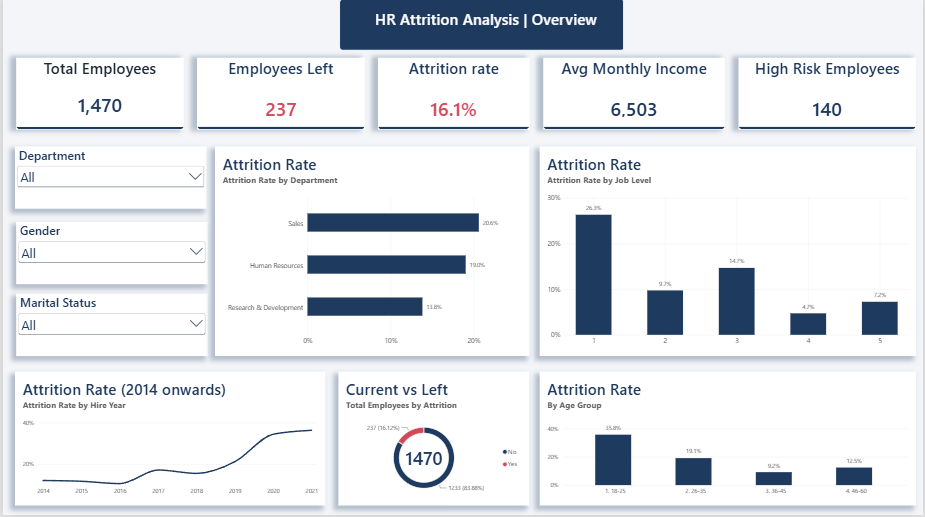
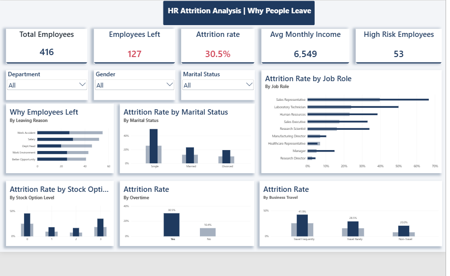
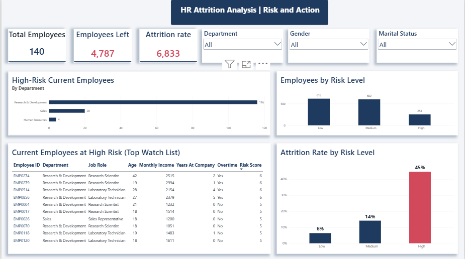

# HR Attrition Analysis

End-to-end HR analytics project analyzing **1,470 employees** to find out *who leaves, why they leave, and who is likely to leave next*, using **MySQL** for cleaning and analysis and **Power BI** for an interactive 3-page dashboard.

---

## 📌 Project Overview

Employee attrition is expensive: hiring, training and lost productivity add up quickly. This project looks at an employee dataset to answer practical HR questions:

- What is the overall attrition rate, and which departments and roles are hit hardest?
- What do leavers have in common (overtime, pay, tenure, travel, marital status, stock options)?
- Can a simple, explainable **risk score** flag current employees who look like past leavers?

**Headline result:** 237 of 1,470 employees left (**16.1%**). Employees with a **High** risk score left at **44.7%** versus **6.3%** for **Low** risk, and **140 current employees** are in the High-risk group.

---

## 🛠️ Tools Used

- **MySQL 8**: data cleaning, CTEs, window functions, views, CASE bucketing
- **Power BI**: data modeling, DAX measures, interactive dashboard design
- **GitHub**: version control and documentation

---

## 🗂️ Repository Structure

```
├── data/
│   └── hr_attrition_import.csv          # Raw data loaded into MySQL (1,470 rows)
├── sql/
│   ├── 02_data_cleaning.sql             # Quality checks + clean `employees` table
│   └── 03_analysis_queries.sql          # 16 analysis queries + 3 views (incl. risk score)
├── powerbi/
│   ├── HR_Attrition_Dashboard.pbix      # Power BI report
│   ├── HR_Attrition_Dashboard.pdf       # PDF export of all 3 pages
│   └── HR_Theme.json                    # Custom theme
├── screenshots/
│   ├── 06_powerbi_model.png
│   ├── 07_powerbi_overview.png
│   ├── 08_powerbi_why_people_leave.png
│   └── 09_powerbi_risk_and_action.png
└── README.md
```

---

## 🧹 Data Cleaning (MySQL)

Raw data was imported into `hr_raw`, then cleaned into a new `employees` table:

- Added a unique `employee_id` (the raw file had none)
- Ran 6 data-quality checks: duplicates, missing values, impossible values, text spacing, bad dates, logic issues
- Converted the hire date text (`dd-mm-yyyy`) to a real `DATE`
- Standardized labels (e.g. `Travel_Frequently` → `Travel Frequently`, `FullTime` → `Full Time`)
- Created readable labels for coded scores (satisfaction, involvement, performance)
- Created bands for age, tenure, income and commute distance
- Created an `attrition_flag` (1 = left) to make rates easy to calculate
- Found a data logic issue: a leaving reason was filled in even for current employees, so it was kept only for leavers

---

## 🧮 SQL Analysis

`03_analysis_queries.sql` covers company KPIs, attrition by department / job role / job level / overtime / travel / marital status / satisfaction / stock options / gender, leavers vs stayers, hire-year cohorts, and a CTE finding the riskiest role + overtime segments.

**Rule-based risk score (0–7 points)**, 1 point each for: overtime, income under 3,000, tenure of 0-1 years, single, job level 1, frequent travel, no stock options. **High** = 4+ points, **Medium** = 2-3, **Low** = 0-1. It is built into the view `vw_employee_analysis`, which feeds Power BI.

---

## 📊 Dashboard

### Page 1: Overview
KPI cards, attrition by department, age group, hire year and job level.



### Page 2: Why People Leave
Attrition by overtime, business travel, marital status, stock options and job role, plus leaving reasons.



### Page 3: Risk and Action
Attrition by risk level, high-risk current employees by department, and a top-10 watch list.



**Interactivity:** synced Department / Gender / Marital Status slicers across pages, cross-filtering charts, and page navigation.

**DAX measures used:** Total Employees, Employees Left, Current Employees, Attrition Rate, Company Attrition Rate, Avg Monthly Income (overall / leavers / stayers), Avg Tenure, High Risk Current Employees, Share of All Leavers, Watch Priority.

---

## 💡 Key Insights

| # | Finding | Number |
|---|---|---|
| 1 | Overall attrition | **16.1%** (237 of 1,470) |
| 2 | Overtime is the strongest single signal | **30.5%** with overtime vs **10.4%** without |
| 3 | Single employees working overtime | **49.6%** attrition (65 of 131) |
| 4 | Leavers earn much less | Avg income **4,787** vs **6,833** for stayers |
| 5 | Highest-attrition role | Sales Representative **39.8%**, then Laboratory Technician **23.9%** |
| 6 | Entry level and new joiners leave most | Job Level 1: **26.3%**; tenure 0-1 yrs: **34.9%** |
| 7 | Stock options matter | No stock options: **24.4%** vs 7.6% - 9.4% for levels 1-2 |
| 8 | Frequent travellers | **24.9%** vs 8.0% for non-travellers |
| 9 | Sales has the highest department attrition | Sales **20.6%**, HR **19.0%**, R&D **13.8%** |
| 10 | Risk score separates groups well | High **44.7%**, Medium **14.1%**, Low **6.3%** |

---

## ✅ Recommendations

1. **Review overtime**: cap overtime or add compensation for it, starting with Sales Representatives and Lab Technicians.
2. **Fix early-career pay**: staff earning under 3,000 a month leave at 28.6%.
3. **Strengthen onboarding** for the first year, where attrition is highest.
4. **Offer stock options more widely** to employees currently at level 0.
5. **Run retention conversations with the 140 high-risk current employees**, beginning with the top-10 watch list (most are in R&D: 116, then Sales: 20, HR: 4).

---

## ⚠️ Limitations

- The risk score is a simple, explainable rule set tested on the same data it was built from. It is a screening tool, not a predictive model.
- The dataset is a single snapshot, so patterns show association, not proof of cause.
- A few columns (leaves, absenteeism, work accident, hiring source, education, work mode, leaving reason) are spread almost evenly across groups and look synthetic, so no conclusions were drawn from them.

---

## 🚀 How to Reproduce

1. Create the database `hr_attrition_analysis` in MySQL and import `data/hr_attrition_import.csv` as table `hr_raw` (Table Data Import Wizard).
2. Run `sql/02_data_cleaning.sql`, then `sql/03_analysis_queries.sql`.
3. Open `powerbi/HR_Attrition_Dashboard.pbix` in Power BI Desktop, update the MySQL connection to your server, and refresh.

---

## 👤 Author

**Julfikar Ali**
[LinkedIn](https://www.linkedin.com/in/julfikar1995) · [GitHub](https://github.com/julfikar1995) · zulfikar1944@gmail.com
